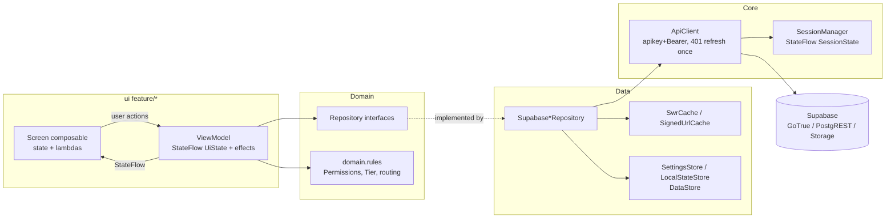

# NEXUS 1.0.0: Architecture

Status: authoritative for all work packages (see WORK-PACKAGES.md). Where this file and older notes disagree, this file wins.
Baseline: branch `rebuild/nexus-2.0` (head 851727d or later): `core/network`, `core/session`, `core/util`, `domain/*`, `ui/designsystem`, navigation shell, auth screen exist.
Product facts: Android (minSdk 26, targetSdk/compileSdk 35), Kotlin 2.0.21 (Compose compiler plugin, strong skipping is ON by default), Compose BOM 2024.12.01, Navigation Compose 2.8.5, OkHttp 4.12, Coil 2.7, DataStore 1.1.1, coroutines 1.9.0. Backend: Supabase (GoTrue, PostgREST, Storage), contract frozen. UI: Arabic first, RTL, English secondary, design "Direction A / الجريدة".
Feature source of truth: FEATURE-INVENTORY.md (432 IDs). Rationale for every non-obvious choice: docs/adr/. Research and sources: BEST-PRACTICES.md.

## 1. Principles

1. Same backend contract, no server changes. Anything the server may or may not allow is guarded on the client and the server error is mapped (ADR-0002).
2. Three layers, one-way dependencies, UDF (section 2, 4).
3. Manual DI through one `AppContainer` (ADR-0001). No new dependencies (ADR-0013).
4. Every screen has loading, empty, error+retry, and content states (X-04), and never shows a raw server string.
5. Server is the authority for permissions and anonymity; client hides and guards, never decides alone (ADR-0004, ADR-0007).
6. Parallel work must not conflict: shared contracts are frozen in section 15 and are created first by WP-01.

## 2. Layers and dependency rule

```
ui (feature/*, navigation, designsystem)  -->  domain (model, repository interfaces, rules)  <--  data (remote/*, local/*)
                 \_______________________________ core (network, session, util) ______________________________/
```

Allowed imports:

| Package | May import | Must NOT import |
|---|---|---|
| `ui.feature.*` | `domain.*`, `core.util`, `core.network.ApiException` (for kind only), `ui.designsystem`, `ui.common`, `ui.navigation.Routes` | `data.*`, `core.network.ApiClient`, other feature packages (cross-feature reuse goes through `ui.common`) |
| `ui.designsystem` | compose, `domain.model` enums only for labels | `data.*`, `core.session` |
| `domain.*` | Kotlin stdlib, coroutines `Flow`, `java.io.InputStream` | android.*, okhttp, org.json (the pure-Kotlin rules in `domain.rules` are JVM-testable) |
| `data.*` | `domain.*`, `core.*` | `ui.*` |
| `core.*` | stdlib, android, okhttp, org.json | `ui.*`, `data.*`, `domain.repository` |

Enforced by review checklist and a unit test `ArchitectureRulesTest` (WP-01) that greps source files for forbidden imports (no new dependency needed).

## 3. Package layout (final)

```
com.nexus.app
  NexusApplication.kt, MainActivity.kt
  core/
    AppContainer.kt
    network/   ApiClient, ApiException(+ApiErrorMapper), PostgrestQuery, JsonExt, UrlEncoding, StreamingRequestBody   (exist)
    session/   SessionManager, SecureSessionStore, SessionModels, LoginIdentifier                                   (exist)
    util/      SafeCall, Clock, DispatcherProvider, DateFormat, SignedUrlCache (exist)
               SwrCache.kt, ConnectivityMonitor.kt, FeatureFlags.kt, Backoff.kt                                      (WP-01)
  domain/
    model/     (exist) + extensions listed in section 15.6
    repository/(exist) + extensions listed in section 15.6
    rules/     Permissions.kt (course, content and admin permissions), Tier.kt, ReportReasons.kt, Limits.kt, UrlValidator.kt,
               NotificationRouter.kt                                                                                (WP-01)
  data/
    remote/    SupabaseAuthRepository, SupabaseProfileRepository, SupabaseStorageRepository, SupabasePinnedCardRepository,
               SupabaseCourseRepository, SupabaseFeedRepository, SupabaseSearchRepository, SupabaseLeaderboardRepository,
               SupabaseMessagingRepository, SupabaseNotificationRepository, SupabaseAdminRepository, Rows.kt (JSON->model mappers)
    local/     SettingsStore (DataStore), LocalStateStore (DataStore: read marks, chat last-seen, drafts, muted, dismissed)
  ui/
    designsystem/ (exist)
    common/    UiText.kt, UiStateExt.kt, ScreenScaffold.kt, PagedList.kt, ReportSheet.kt, ConfirmDialog.kt, OfflineBanner.kt, ... (section 15.3)  (WP-01)
    navigation/ NexusNavHost.kt, Routes.kt, AppGate.kt, MainShell.kt, NavActions.kt
    feature/<name>/ <Name>Screen.kt, <Name>ViewModel.kt, <Name>UiState.kt      (names in SCREEN-MAP.md)
```

A work package owns whole directories (`feature/<name>` or the `data/remote` files of its repositories) so merges never touch the same file. Shared files (AppContainer.kt, Routes.kt, NexusNavHost.kt, strings) are edited only through the protocol in WORK-PACKAGES.md section 2.

## 4. Data flow



Read path: `Screen -> VM.init/refresh() -> repository.suspend fun (throws ApiException) -> safeCall in VM -> UiState`. Write path: action function on VM -> single-flight guard -> optimistic update where listed -> repository call -> on failure rollback and emit `UiEffect.Message(UiText)`.

## 5. Dependency injection

Manual, one container (ADR-0001). `NexusApplication.container` is created once; it is the single owner of every repository (fixes AUTH-29). ViewModels are created with `viewModelFactory { initializer { XViewModel(container.a, container.b, ...) } }` inside the screen's Route composable (`XRoute(container, nav, ...)`). ViewModels receive repository interfaces, never `AppContainer` (keeps them testable). Navigation arguments are read with `SavedStateHandle` (`createSavedStateHandle()` inside `initializer`). Exact container shape: section 15.1.

Sign-out: `AppContainer.onSignedOut()` (called by an observer of `SessionState.SignedOut`) clears `SignedUrlCache`, all `SwrCache` instances, `LocalStateStore` per-user keys, cancels pollers, and resets `currentProfile`. ViewModels are dropped because the NavHost leaves composition when the gate shows Auth.

## 6. State, UDF and effects

* One immutable `data class XUiState` per screen. Collections are `List<T>` (not ImmutableList; ADR-0010). The ViewModel keeps list instances stable between emissions when nothing changed so strong skipping compares by reference.
* Loading modelling: `LoadState` sealed interface (section 15.2) inside UiState: `Loading` (first load, skeleton), `Content`, `Error(UiText)` (first load failed, retry), plus `refreshing: Boolean` and `stale: Boolean` flags for SWR.
* Actions are public ViewModel functions (`onXClicked`). Composables get state and lambdas only; they never call repositories.
* One-shot effects (snackbar, navigate, share intent) are modelled as state to be consumed (`effects` list with `consume(id)`), per the Android UI-events guidance (ADR-0011). `UiEffect` type in section 15.2. A thin `EffectHost` composable (WP-01) shows snackbars with `liveRegion` and runs navigation effects.
* Single-flight: every mutating action is guarded by a per-action in-flight flag in UiState (X-31). Double taps are no-ops.
* Process death: input drafts that matter (composer text, bio, search query, selected filters) live in `SavedStateHandle`; passwords never (SEC-01).
* Collection: `collectAsStateWithLifecycle()` everywhere.

## 7. Navigation

Library: Navigation Compose 2.8.5 with string routes (ADR-0003: the type-safe API needs the kotlinx-serialization plugin, which the allowed-dependency rule forbids). To keep the safety, routes are only built through functions in `Routes`; all route arguments are `String` or nullable `String` (ids), never Int/Boolean, so no NavType surprises. Tabs keep state with `saveState/restoreState`.

### 7.1 Gate (outside the NavHost)

`AppGate` is a sealed state computed from `SessionState` plus the current profile; `NexusNavHost` renders it:

| Gate | Condition | UI | Exit |
|---|---|---|---|
| `Splash` | `SessionState.Initializing` or profile not yet loaded | system splash (`installSplashScreen` keep condition) | loads |
| `SignedOut(reason)` | `SessionState.SignedOut` | `AuthRoute` (login, recover sheet, web-auth button) | sign in |
| `Recovery` | deep link `type=recovery` accepted (`DeepLinkResult.Accepted(recovery=true)`) | `SetNewPasswordScreen` (no current password, AUTH-28) | after success, continue (ADR-0006) |
| `MustChangePassword` | `profile.mustChangePassword` and local override flag not set | `ChangePasswordScreen(forced=true)` | success |
| `Blocked(until?)` | `profile.banned` or `suspendedUntil` in the future (tolerant parse) or no recognised role | `AccountBlockedScreen` (+ sign out) | sign out; re-checked on resume |
| `Main` | otherwise | `MainShell` with the NavHost | |

The gate re-evaluates on `ON_RESUME` (profile refresh, throttled 60 s) and on any Forbidden error that the repository flags as account-status (AUTH-17). A deep link or notification received while signed out is stored in `pendingRoute` (in memory, plus SavedStateHandle) and replayed after `Main` (NAV-14).

### 7.2 Route table (final, constants in `Routes`)

All routes live in one `NavHost(startDestination = Routes.HOME)` inside `MainShell` except the auth gate screens. Pattern syntax: `{x}` required path arg; `?x={x}` optional query arg (String, default null).

| Constant | Pattern | Arguments (all String) | Screen |
|---|---|---|---|
| `HOME` | `home` | none | HomeScreen (tab) |
| `COURSES` | `courses` | none | CoursesScreen (tab) |
| `COMMUNITY` | `community` | none | FeedScreen (tab) |
| `MESSAGES` | `messages` | none | MessagesScreen (tab) |
| `PROFILE` | `profile` | none | ProfileScreen (tab) |
| `COURSE` | `course/{courseId}?tab={tab}` | `courseId` required; `tab` in files, links, discussions, updates, schedule | CourseDetailScreen |
| `POST` | `post/{postId}?comment={commentId}` | `postId` required; `commentId` optional (scroll/highlight) | PostDetailScreen |
| `COMPOSE` | `compose?course={courseId}&type={type}` | both optional (`type` general or question) | ComposerScreen |
| `SAVED` | `saved` | none | SavedScreen |
| `SEARCH` | `search?q={q}` | `q` optional | SearchScreen |
| `USER` | `user/{userId}` | `userId` required | PublicProfileScreen |
| `NOTIFICATIONS` | `notifications` | none | NotificationsScreen |
| `LEADERBOARD` | `leaderboard` | none | LeaderboardScreen |
| `WARNINGS` | `warnings` | none | WarningsScreen |
| `SETTINGS` | `settings` | none | SettingsScreen |
| `SETTINGS_PASSWORD` | `settings/password` | none | ChangePasswordScreen(forced=false) |
| `SETTINGS_BLOCKED` | `settings/blocked` | none | BlockedUsersScreen |
| `SETTINGS_ABOUT` | `settings/about` | none | AboutScreen |
| `CHAT` | `chat/{conversationId}` | `conversationId` required | ChatScreen |
| `NEW_CHAT` | `messages/new` | none | FindUsersScreen (find users, start DM) |
| `NEW_GROUP` | `messages/new-group` | none | NewGroupScreen |
| `ADMIN` | `admin` | none | AdminHomeScreen |
| `ADMIN_USERS` | `admin/users` | none | AdminUsersScreen |
| `ADMIN_USER` | `admin/users/{userId}` | `userId` required | AdminUserDetailScreen |
| `ADMIN_REPORTS` | `admin/reports` | none | AdminReportsScreen |
| `ADMIN_REPORT` | `admin/reports/{reportId}?type={type}` | `reportId` required; `type` post or message | AdminReportDetailScreen |
| `ADMIN_COURSES` | `admin/courses` | none | AdminCoursesScreen |
| `ADMIN_COURSE_EDIT` | `admin/courses/edit?courseId={courseId}` | optional (absent = create) | CourseEditorScreen |
| `ADMIN_TEACHERS` | `admin/teachers` | none | AdminTeachersScreen |
| `ADMIN_SUBADMINS` | `admin/subadmins` | none | AdminSubAdminsScreen |
| `ADMIN_WORDS` | `admin/words` | none | AdminWordsScreen |
| `ADMIN_ACTIVITY` | `admin/activity` | none | AdminActivityScreen |
| `ADMIN_PINNED` | `admin/pinned` | none | AdminPinnedScreen |
| `ADMIN_BROADCAST` | `admin/broadcast` | none | AdminBroadcastScreen |
| `ADMIN_CONTENT` | `admin/content` | none | AdminContentScreen (recent posts/comments digest, ADM-45) |
| `NOT_FOUND` | `not-found?what={what}` | optional | NotFoundScreen (NAV-16) |

Auth gate screens (Login, SetNewPassword, ChangePassword forced, Blocked) are rendered by the gate, not routes; `ChangePasswordScreen` is reused by `SETTINGS_PASSWORD`.

### 7.3 Navigation rules

* Bottom bar: Home, Courses, Community, Messages (badge = unread conversations), Profile. Secondary entries (Search, Notifications with badge, Leaderboard, Saved) are persistent actions in top bars: Home top bar has Search and Notifications; Profile lists Saved, Leaderboard, Warnings, Settings, Admin (NAV-17).
* Back: the origin screen, never a hardcoded tab (CHAT-32, NAV-09). Predictive back enabled in the manifest (`android:enableOnBackInvokedCallback="true"`). Bottom bar is hidden on full-screen routes (chat, compose, admin editors).
* Notification/link to route: `NotificationRouter.routeFor(link, type, id)` in `domain.rules` (pure, unit-tested) returns a route string or null. Mapping default: `/posts/<id>` or `post:<id>` -> `post/<id>`; `/courses/<id>` -> `course/<id>`; `/messages/<id>` -> `chat/<id>`; `/profile/<id>` -> `user/<id>`; synthesized ids `comment_<postId>_...`, `react_<postId>`, `msg_<conversationId>`, `warn_*` map to post, post, chat, warnings. Unknown -> no navigation (the row only marks read).
* Only host `login-callback` of scheme `com.nexus.app` is accepted (NAV-18); App Links are deferred (ADR-0012).

## 8. Error model

* Repositories throw only `ApiException` (kind: Network, Unauthorized, Forbidden, NotFound, Validation, Server, Unknown; `userMessage` Arabic; `serverMessage` raw, never displayed; `errorCode`).
* ViewModels use `safeCall { }` (returns `Result<T>`, rethrows `CancellationException`).
* UI text: `Throwable.toUiText(): UiText` (section 15.2). Mapping: Network, Unauthorized, Forbidden, NotFound, Server map to string resources (`err_network`, `err_session`, `err_forbidden`, `err_not_found`, `err_server`) so English works; Validation/Unknown keep `userMessage` when it contains Arabic (server rule messages such as banned words, ADM-29) otherwise `err_unknown`.
* Unauthorized after the single refresh retry is terminal: `SessionManager` publishes `SignedOut(reason)`; UI shows the notice on the login screen (AUTH-21).
* Forbidden is ambiguous (RLS or account state). Repositories do not guess; the VM shows `err_forbidden`; for write actions on screens guarded by `Permissions`, the control was already hidden (ADR-0002).
* Optimistic actions (reaction, save, send message, pinned vote, mark read) roll back on failure and emit a message. Writes that cannot be rolled back show a retry affordance (failed message bubble with retry, composer keeps text).
* Never log tokens, signed URLs, response bodies in release (SEC-07; R8 strips `Log.v/d`).

## 9. Caching (stale-while-revalidate)

`SwrCache<K, V>` (WP-01, `core/util`): in-memory, thread-safe, `ttlMillis` default 60 000, `maxEntries` 64, API `peek(key)`, `put`, `invalidate(key)`, `clear()`. Repositories that benefit hold one cache each (courses list, course detail, home, conversations, notifications page 1, leaderboard per filter, pinned card, profile). Rules:

* For instant paint the ViewModel first calls the optional `peekX()` method (section 15.6: Home via `peekCourses`, Courses, Conversations, Profile, PinnedCard) which returns the cached value or null, shows it with `stale=true`, then calls the normal `loadX()` which always fetches fresh and refills the cache. Interfaces stay simple: the cache is internal to the Supabase repository.
* Mutations invalidate the affected keys (adding a material invalidates `courseDetail(id)` and `home`).
* Cache never survives sign-out or account switch (AUTH-30, X-09). No disk cache of content in 1.0.0 (offline = last in-memory data while the process lives, plus an Offline banner and retry; ADR-0009).
* `SignedUrlCache` (exists) holds signed storage URLs for 50 min of a 60 min signature (X-18).

## 10. Pagination

* Feed, saved, notifications, chat history, search "more", admin users/reports: keyset pagination on `created_at` (and `id` as tiebreaker for equal timestamps) with `order=created_at.desc,id.desc&limit=N` (ADR-0021); `Page<T>(items, nextCursor)`; `nextCursor == null` when fewer than `limit` rows returned. Cursor string format: `<created_at>|<id>` (opaque to UI).
* Page sizes: feed 20, saved 20, notifications 30, chat 50, search 40 per type, admin lists 50. Never rely on one unbounded request: PostgREST caps rows (default max 1000) so counts that need more use `Prefer: count=exact` with `Range: 0-0`, not list lengths (X-13).
* UI: `PagedLazyColumn` helper triggers `onLoadMore` when the last 5 items are visible; a footer shows loading/error-retry.

## 11. Polling and background activity

| Poller | Interval | Runs when | Backoff |
|---|---|---|---|
| Chat messages (open conversation) | 4 s (`created_at=gt.<last>`, no full replace) | screen RESUMED and online | on failure 4 -> 8 -> 16 -> 30 s, reset on success; show "reconnecting" strip after 2 failures |
| Block status | with chat open: on open and every 60 s | chat RESUMED | n/a |
| Conversations list | 15 s | Messages tab RESUMED | same |
| Unread totals (notifications count + chat unread) | 60 s | app STARTED (driven by `MainShell` `repeatOnLifecycle(STARTED)`) | 60 -> 120 -> 300 s |
| Session account-status check | on resume, throttled 60 s | | |

All loops are `repeatOnLifecycle` in the composable route or a ViewModel flow tied to it, cancelled when leaving. No WorkManager, no foreground service, no push in 1.0.0 (ADR-0005, ADR-0008). `Backoff` helper in core/util.

## 12. Image and file pipeline

* Buckets: `avatars` (path `<uid>/<ts>-<uuid>.<ext>`), `post-images` (`<uid>/<ts>-<uuid>.<ext>`), `course-files` (`<courseId>/<ts>-<uuid>-<safeName>`). DB stores the path, not a URL. Legacy values that are full URLs are resolved by `avatarDisplayUrl` (PROF-27).
* Display: `StorageRepository.signedUrls(bucket, paths)` batches (one request per bucket per screen load), results in `SignedUrlCache`. Coil loads the signed URL; `AsyncSignedImage` with placeholder and error state; on 403/expired the composable invalidates the key and re-signs once (FEED-37).
* Upload: pick with `ActivityResultContracts.PickVisualMedia` (images) or `OpenDocument` (course files), wrap in `UploadSource` (streams, no full read into memory), validate in `Limits` + `StorageRepository` (MIME allow list, size: avatar 5 MB, post image 10 MB, course file 100 MB; magic-byte sniff for images; SEC-14), upload with `ApiClient.upload` (token refreshed first, `x-upsert: false`, upload client has no call timeout, cancellable through coroutine cancel). Progress via `StreamingRequestBody` callback into `UploadState(progress, error)` in the VM. Failed post publish after upload: keep uploaded paths in the VM and retry publish only (FEED-39); on abandon, best-effort `deleteObject` of orphans.
* Open course file: `resolveMaterialUrl` then `Intent.ACTION_VIEW` through `UrlValidator` (https only); no in-app viewer in 1.0.0 (CRS-28 deferred).
* Links from users (materials, pinned button, messages) pass `UrlValidator.isSafeHttpUrl` before any intent (SEC-06).

## 13. Session and security

* Tokens: `SecureSessionStore` (AES-GCM Keystore alias `nexus.session.aes`, format unchanged so 1.x users stay signed in); never wiped on transient decrypt errors.
* `ApiClient`: `apikey` always, `Authorization: Bearer` except GoTrue token/signup/recover; 401 -> single refresh (Mutex, 90 s window) -> single retry; `logout?scope=local`.
* Deep link `com.nexus.app://login-callback` validated with state/nonce, token verified through `/auth/v1/user` before storing.
* `allowBackup=false` + `data_extraction_rules.xml` (exclude all), `usesCleartextTraffic=false` + `network_security_config.xml` (base-config cleartext false), https-only assertion for `SUPABASE_URL` at container creation (SEC-09). `FLAG_SECURE` deferred.
* PostgREST filters only through `PostgrestQuery` (encoding and wildcard/`, ( )` escaping).
* Anonymous content: rows are masked by `forViewer` in repositories (not in UI) so no composable ever holds a masked author id; staff reveal uses `get_anonymous_authors` through an explicit `revealAnonymousAuthors` call (ADR-0007).
* No service-role key anywhere; CI reads only the publishable key.
* Release hardening: R8 with resource shrinking, `proguard-rules.pro` keeps nothing reflective (no serialization/reflection in code), `-assumenosideeffects` for `Log.v/d`.

## 14. Theming, i18n, RTL, accessibility

* Theme: `NexusTheme(themeMode, dynamicColor)` reads `AppSettings` from `SettingsRepository` at the root; dynamic color only on API 31+, default off (the Direction A palette is the brand). Dark scheme must define all M3 roles (SET-16).
* Strings: all user-visible text in `res/values/strings*.xml` (Arabic, default) and `res/values-en/strings*.xml`. Plurals with Arabic `zero/one/two/few/many/other` (I18N-02). Enum labels (roles, majors, report status, timeframe) come from string resources through `@Composable` mappers in `ui/common/Labels.kt` (domain enum `label` fields that contain Arabic literals are legacy and must not be shown; ADR-0014). Reasons sent to the server stay a fixed Arabic canonical string (`ReportReasons`, I18N-06).
* Language: in-app language switch with per-app locales: `AppCompatDelegate.setApplicationLocales` needs `androidx.appcompat` which is not in the allowed list, so use platform `LocaleManager` on API 33+ and, below, wrap the Activity context in `attachBaseContext` using the stored `AppLanguage` (ADR-0015). Layout direction follows the locale; no forced RTL.
* RTL: use `start/end`, `Arrangement.Start`, `Icons.AutoMirrored.*` for arrows/send. Numbers: Latin digits by default for ids, counts and times; no digit conversion of user input except login identifier normalisation.
* Fonts: Amiri (headlines) and Tajawal (UI) downloaded in CI; no negative letter spacing.
* Accessibility: every clickable at least 48dp (`Modifier.minimumInteractiveComponentSize()` or `NexusDims.Touch`); `contentDescription` for icons and avatars (person's name); headings via `semantics { heading() }`; `Role` on custom clickables; state descriptions for toggles and expandables; no information by color alone; contrast at least 4.5:1 (gold on paper is decoration only, text uses `ink`/`accentDark`); long press actions have `customActions`; Snackbar announced; font scale 2.0 must not clip (use `heightIn(min)` not fixed heights); reduce-motion check through `Settings.Global.ANIMATOR_DURATION_SCALE == 0` disables splash/animation (A11Y-09).

## 15. Contracts (frozen; WP-01 creates them, all others rely on them)

### 15.1 AppContainer (exact)

```kotlin
package com.nexus.app.core

class AppContainer(context: Context) {
    // existing (keep names)
    val applicationScope: CoroutineScope
    val apiClient: ApiClient
    val sessionManager: SessionManager
    val authNotice: MutableStateFlow<String?>
    val restoreJob: Job

    // new (WP-01 declares all with real constructors; data WPs replace the implementation classes)
    val dispatchers: DispatcherProvider                  // DefaultDispatcherProvider
    val clock: Clock                                     // DefaultClock
    val signedUrlCache: SignedUrlCache
    val connectivity: ConnectivityMonitor                // StateFlow<Boolean> isOnline
    val featureFlags: FeatureFlags
    val settingsStore: SettingsStore                     // data.local, DataStore preferences
    val localState: LocalStateStore                      // data.local, per-user local keys

    val authRepository: AuthRepository
    val profileRepository: ProfileRepository
    val courseRepository: CourseRepository
    val feedRepository: FeedRepository
    val messagingRepository: MessagingRepository
    val notificationRepository: NotificationRepository
    val searchRepository: SearchRepository
    val leaderboardRepository: LeaderboardRepository
    val adminRepository: AdminRepository
    val storageRepository: StorageRepository
    val pinnedCardRepository: PinnedCardRepository
    val settingsRepository: SettingsRepository

    /** Current user's profile; null when signed out or not loaded. Single source for roles/permissions. */
    val currentProfile: StateFlow<StudentProfile?>
    suspend fun refreshCurrentProfile()                  // throttled; updates currentProfile

    fun onSignedOut()                                    // clears caches, local per-user state, currentProfile
}
```

Until a data WP lands, WP-01 wires `Unsupported*Repository` stubs (every method throws `ApiException(ApiErrorKind.Unknown, ...)`; Flow members emit empty) so the app always compiles and screens can be developed in parallel against interfaces. Each data WP replaces exactly its own lines in the container and its stub file. ViewModels depend on interfaces only, and tests use fakes in `app/src/test/.../testutil/` (WP-01 provides `MainDispatcherRule`; each data WP owns the fakes of its interfaces).

`FeatureFlags` (data class, built from BuildConfig and constants): `nameChangeRequests=false`, `chatGroupManagement=false` (until RLS confirmed), `commentAndUserReports=false`, `accountSelfDelete=false`, `adminClientLogging=false`, `contentEditing=false`, `webAuthEnabled = WEB_AUTH_URL.isNotBlank()`, `shareBaseUrl: String?` (origin of WEB_AUTH_URL, null = share plain text).

### 15.2 UiText and error mapping

```kotlin
package com.nexus.app.ui.common

sealed interface UiText {
    data class Plain(val value: String) : UiText
    class Res(@StringRes val id: Int, vararg val args: Any) : UiText
    class Plural(@PluralsRes val id: Int, val count: Int, vararg val args: Any) : UiText
}
@Composable fun UiText.asString(): String
fun UiText.asString(context: Context): String
fun Throwable.toUiText(): UiText        // ApiException -> as described in section 8; others via toApiException()
fun ApiException.isAuthTerminal(): Boolean   // kind == Unauthorized
```

ViewModels never hold `Context`; they put `UiText` in state/effects. Hard-coded Arabic from `ApiErrorMapper` is accepted only through `Plain` when the server message is Arabic (rule messages).

Shared UI state types (`ui/common/UiStateExt.kt`):

```kotlin
sealed interface LoadState { object Loading : LoadState; object Content : LoadState; data class Error(val message: UiText) : LoadState }
sealed interface UiEffect {
    data class Message(val id: Long, val text: UiText, val actionLabel: UiText? = null) : UiEffect
    data class Navigate(val id: Long, val route: String) : UiEffect
    data class OpenUrl(val id: Long, val url: String) : UiEffect
    data class Share(val id: Long, val text: String) : UiEffect
}
abstract class EffectViewModel : ViewModel() { val effects: StateFlow<List<UiEffect>>; protected fun emit(effect: UiEffect); fun consume(id: Long) }
```

### 15.3 Common composables that must exist (`ui/common`, WP-01) in addition to existing designsystem

Existing (keep): `NexusTheme, NexusMasthead, NexusBottomBar, Rule, DoubleRule, Kicker, SectionHeader, Tag, MarkTag, NexusButton, NexusFab, QuoteBox, Avatar, EmptyState, ErrorState, LoadingSkeletonLine, ChatBubble, NexusIconView, UnderlineField`.
New:

| Composable | Purpose |
|---|---|
| `ScreenScaffold(title, onBack: (() -> Unit)?, actions, snackbarEffects, content)` | top bar (masthead style), edge-to-edge insets, snackbar host with liveRegion |
| `EffectHost(effects, onConsume, onNavigate, snackbarHostState)` | renders `UiEffect` |
| `StateContent(loadState, refreshing, onRetry, onRefresh, skeleton, empty, content)` | loading/skeleton, error with retry, pull-to-refresh, stale hint |
| `PagedLazyColumn(...)` | infinite scroll with footer (canLoadMore, loadingMore, loadMoreError, onLoadMore) |
| `ConfirmDialog(title, message, confirmLabel, destructive, onConfirm, onDismiss)` and `TypedConfirmDialog(requiredText, ...)` | confirmations; typed confirmation for deletes (ADM-11) |
| `ReasonSheet(title, reasons: List<UiText>, withNote, onSubmit(reason, note))` | basis of `ReportSheet` |
| `ReportSheet(kind, onSubmit)` | reasons from `ReportReasons` |
| `OfflineBanner(isOnline)` | offline strip (X-02) |
| `VerifiedBadge`, `RoleBadge(role)`, `PointsChip`, `TierChip` | PROF-09/10/08 |
| `UserAvatar(name, signedUrl, verified, size)` | wraps `Avatar` with a11y description |
| `SocialText(text, onMention, onLink)` | links and @mentions (FEED-21/29), uses `UrlValidator` |
| `RelativeTimeText(iso)` | uses `DateFormat` and plurals |
| `ImageViewer(urls, startIndex, onDismiss)` | full screen pager, pinch zoom |
| `AsyncSignedImage(bucket, path, ...)` | resolves via `StorageRepository`, one retry on error |
| `ChipRow(options, selected, onSelect)`, `SectionDivider` | |
| `AnonymousRevealRow(author?)` | staff-only display (ADM-35, FEED-07) |
| `PasswordField(value, onChange, visible, onToggle, label, imeAction)` | no `rememberSaveable` for the value |

All composables: stable params, `modifier: Modifier = Modifier` as first optional param. Feature-specific cards (PostCard, CourseCard) are owned by feature WPs, not shared.

### 15.4 Navigation contracts

`Routes` object (constants and builders; WP-01 completes it; consumers never concatenate strings):

```kotlin
object Routes {
    const val HOME = "home"; const val COURSES = "courses"; const val COMMUNITY = "community"
    const val MESSAGES = "messages"; const val PROFILE = "profile"
    const val COURSE = "course/{courseId}?tab={tab}"
    const val POST = "post/{postId}?comment={commentId}"
    const val COMPOSE = "compose?course={courseId}&type={type}"
    const val SAVED = "saved"; const val SEARCH = "search?q={q}"; const val USER = "user/{userId}"
    const val NOTIFICATIONS = "notifications"; const val LEADERBOARD = "leaderboard"; const val WARNINGS = "warnings"
    const val SETTINGS = "settings"; const val SETTINGS_PASSWORD = "settings/password"
    const val SETTINGS_BLOCKED = "settings/blocked"; const val SETTINGS_ABOUT = "settings/about"
    const val CHAT = "chat/{conversationId}"; const val NEW_CHAT = "messages/new"; const val NEW_GROUP = "messages/new-group"
    const val ADMIN = "admin"; const val ADMIN_USERS = "admin/users"; const val ADMIN_USER = "admin/users/{userId}"
    const val ADMIN_REPORTS = "admin/reports"; const val ADMIN_REPORT = "admin/reports/{reportId}?type={type}"
    const val ADMIN_COURSES = "admin/courses"; const val ADMIN_COURSE_EDIT = "admin/courses/edit?courseId={courseId}"
    const val ADMIN_TEACHERS = "admin/teachers"; const val ADMIN_SUBADMINS = "admin/subadmins"
    const val ADMIN_WORDS = "admin/words"; const val ADMIN_ACTIVITY = "admin/activity"
    const val ADMIN_PINNED = "admin/pinned"; const val ADMIN_BROADCAST = "admin/broadcast"; const val ADMIN_CONTENT = "admin/content"
    const val NOT_FOUND = "not-found?what={what}"

    fun course(courseId: String, tab: String? = null): String
    fun post(postId: String, commentId: String? = null): String
    fun compose(courseId: String? = null, type: String? = null): String
    fun search(q: String? = null): String
    fun user(userId: String): String
    fun chat(conversationId: String): String
    fun adminUser(userId: String): String
    fun adminReport(reportId: String, type: String): String
    fun adminCourseEdit(courseId: String? = null): String
    fun notFound(what: String? = null): String
    val TAB_ROUTES: Set<String>
}
```
Builders URL-encode values (`Uri.encode`). Argument names above are the `navArgument` names; each optional arg is `nullable = true, defaultValue = null`.

Each feature exposes one entry composable `fun <Name>Route(container: AppContainer, nav: NavActions, ...)`. `NavActions` (WP-01) is a class with lambdas: `back()`, `openCourse(id, tab?)`, `openPost(id, commentId?)`, `openUser(id)`, `openChat(id)`, `openCompose(courseId?, type?)`, `openSearch(q?)`, `openRoute(route: String)` (used by NotificationRouter), `openUrl(url)`. Features never hold a `NavController`.

### 15.5 Domain rules (pure Kotlin, `domain/rules`, WP-01)

```kotlin
object Limits { const val POST = 2000; const val COMMENT = 1000; const val MESSAGE = 1000; const val BIO = 300
  const val GROUP_NAME = 60; const val GROUP_MAX_MEMBERS = 100; const val REPORT_NOTE = 500
  const val ANNOUNCEMENT_TITLE = 100; const val ANNOUNCEMENT_BODY = 1000; const val COURSE_UPDATE = 1000
  const val MATERIAL_TITLE = 120; const val MATERIAL_NOTE = 300; const val BANNED_WORD_MIN = 2
  const val POST_IMAGES = 4; const val AVATAR_BYTES = 5L*1024*1024; const val POST_IMAGE_BYTES = 10L*1024*1024
  const val COURSE_FILE_BYTES = 100L*1024*1024; const val PASSWORD_MIN = 8 }

object UrlValidator { fun isSafeHttpUrl(url: String?): Boolean /* https only, no userinfo */ ; fun normalizeUserLink(input: String): String? }

object Permissions {   // course, content and admin permissions; all take StudentProfile
  fun canPost(p: StudentProfile, nowMillis: Long): Boolean            // not banned, not suspended (tolerant parse); sub_admin may post (ADR-0004)
  fun canComment(p: StudentProfile, nowMillis: Long): Boolean
  fun canManageCourse(p: StudentProfile, course: Course): Boolean       // admin, sub_admin with COURSES, or teacher == course.teacherId
  fun canAddMaterial(p: StudentProfile, course: Course): Boolean        // same as above
  fun canAcceptAnswer(p: StudentProfile, post: FeedPost): Boolean       // post author (not masked), staff, course teacher
  fun canDeletePost(p: StudentProfile, post: FeedPost): Boolean
  fun canDeleteComment(p: StudentProfile, comment: FeedComment, postAuthorId: String?): Boolean
  fun canRevealAnonymous(p: StudentProfile): Boolean                    // admin, or sub_admin with REPORTS
  fun canMessage(p: StudentProfile, nowMillis: Long): Boolean           // not banned/suspended
  fun admin(p: StudentProfile): AdminAccess
  fun isAccountBlocked(p: StudentProfile, nowMillis: Long): AccountBlock?   // banned / suspended until / no role
}
class AdminAccess(val isAdmin: Boolean, val tabs: Set<AdminTab>, val canWarn: Boolean, val canSuspend: Boolean, val canBan: Boolean,
   val canVerify: Boolean, val canAdjustPoints: Boolean, val canSetYear: Boolean, val canDeleteUser: Boolean, val canChangeRole: Boolean,
   val canReports: Boolean, val canCourses: Boolean, val canWords: Boolean, val canTeachers: Boolean, val canCreateSubAdmin: Boolean,
   val canPinned: Boolean, val canBroadcast: Boolean, val canActivity: Boolean, val canRevealAnonymous: Boolean)
enum class AdminTab { OVERVIEW, USERS, REPORTS, COURSES, TEACHERS, SUBADMINS, WORDS, ACTIVITY, PINNED, BROADCAST, CONTENT }
fun canActOnTarget(actor: StudentProfile, target: AdminUser): Boolean   // protected accounts (ADM-41, ADR-0004)

object Tier { fun forPoints(points: Int): TierLevel }   // PROF-08/LEAD-10, ADR-0016
object ReportReasons { val post: List<ReportReason>; val message: List<ReportReason> }  // canonical Arabic stored value + string res id
object NotificationRouter { fun routeFor(link: String?, type: NotificationType, id: String): String? }
```

### 15.6 Domain extensions (WP-01 adds these to the existing interfaces and models in one commit; data WPs implement)

Models:
* `ConversationPreview` add `lastSenderId: String? = null`, `unread: Boolean = false`.
* `ProfileCounts(posts: Int, comments: Int, acceptedAnswers: Int)`; `UserWarning(id, reason, createdAt, issuedBy: String?)`.
* `AdminPinnedDraft` (PinnedCardConfig fields without votes/participants) plus `AdminPinnedStats(votesByOption: Map<String,Int>, participantsCount: Int)`.
* `AdminCourseDraft(id: String?, name, description, major, year, semester, teacherId: String?, schedule: List<ScheduleEntry>)`.
* `AdminContentItem(kind: post|comment, id, postId, authorName, content, createdAt, anonymous)`.
* `AdminUserDetail(user: AdminUser, warnings: List<UserWarning>, actions: List<AdminActivity>, reportsAgainst: Int)`; `AdminCounts`.
* `RecoveryOutcome` (Sent | SubAdminNotSupported).

Repositories (new methods; WP-01 adds them to the interfaces; the `Unsupported*` stubs throw):
* `AuthRepository`: `suspend fun completePasswordChange(newPassword: String)` (PUT user, then PATCH `must_change_password=false`; a refused PATCH is swallowed and recorded in `LocalStateStore`), `suspend fun requestRecovery(identifier: String): RecoveryOutcome` (the old `recoverPassword` delegates).
* `ProfileRepository`: `loadProfileCounts(userId)`, `removeAvatar()`, `loadWarnings(): List<UserWarning>`, `peekCurrentProfile(): StudentProfile?`.
* `MessagingRepository`: `fun observeUnreadConversations(): Flow<Int>`, `markConversationSeen(conversationId, upTo)`, `loadBlockedUsers(): List<PublicUser>`, `peekConversations(): List<ConversationPreview>?`, `leaveConversation(id)` and `renameConversation(id, name)` (UI gated by flag).
* `NotificationRepository`: `loadNotificationDetail(id: String): NotificationItem?` (long announcements, NOTIF-21).
* `CourseRepository`: `loadCourses(): List<Course>` (with counts via RPC fallback), `peekCourses(): List<Course>?`, `editCourseMaterial(materialId, title, note, url)`, `loadQuestionsPage(courseId, cursor)`, `deleteCourseQuestion(postId)`, `acceptCourseAnswer(postId, commentId?)`, `reportCourseContent(postId, reason)`.
* `FeedRepository`: `revealAnonymousAuthors(postIds: Set<String>, commentIds: Set<String>): Map<String, AnonymousAuthor>`, `loadPostsByAuthor(userId, cursor, limit = 20): Page<FeedPost>`, `editPost(postId, content)`, `editComment(commentId, content)` (guarded by `contentEditing` flag), `loadPostReactors(postId): List<FeedReaction>`.
* `AdminRepository`: `loadAdminUserPage(cursor, query, filter)`, `loadAdminCounts()`, `loadUserDetail(userId)`, `createStudentAccount(...)`, `setUserRole(userId, role, on)`, `saveCourse(draft)`, `deleteCourse(id)`, `loadPinnedDraft()`, `savePinnedCard(draft)`, `loadPinnedStats()`, `resetUserPassword(userId)` (guarded), `loadContentDigest()`, `logAdminAction(...)` (off by default, ADR-0019). `broadcastAnnouncement` already exists (RPC if present, else batched insert, SEC-10). `updateAdminReportStatus` accepts only the four `ReportStatus` values.
* `StorageRepository`: add `deleteObject(bucket, path)`.
* `PinnedCardRepository`: add `peekPinnedCard()`. Search, Leaderboard, Settings repositories unchanged.

Ownership: WP-01 edits the interface and model files once; data WPs may only add private helpers and must not change signatures without an ADR amendment.

### 15.7 Strings protocol

Each WP adds its strings under a prefix (`auth_`, `home_`, `course_`, `feed_`, `post_`, `chat_`, `msg_`, `profile_`, `settings_`, `notif_`, `search_`, `lead_`, `admin_`, `err_`, `common_`) in its OWN resource files `res/values/strings_<area>.xml` and `res/values-en/strings_<area>.xml` (never in `strings.xml`) so merges do not conflict. Duplicated resource names across files break the build: the prefix is the namespace.
