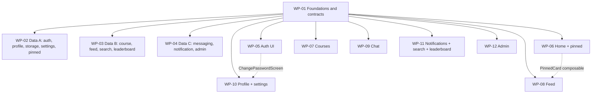

# NEXUS 1.0.0: Work packages

Twelve packages, each sized for one agent. Read ARCHITECTURE.md (especially section 15 Contracts), SCREEN-MAP.md (your rows) and the ADRs you are named in before starting. No local compiler: CI compiles. Write simple, conventional Kotlin; check imports, nullability, named arguments, exhaustive `when`.

## 1. Order and dependencies

* **Wave 0:** WP-01 alone (about the size of two feature packages; it is the only blocker). It merges first.
* **Wave 1 (parallel, all depend only on WP-01):** WP-02, WP-03, WP-04 (data) and WP-05 to WP-12 (UI). UI packages code against interfaces and stubs/fakes from WP-01, so they do not wait for data. Integration happens automatically because the container swaps `Unsupported*Repository` for `Supabase*Repository`.
* **Soft dependencies:** WP-08 uses the `PinnedCard` composable from WP-06 (if WP-06 is not merged yet, WP-08 leaves a `TODO(WP-06)` call site guarded by a placeholder); WP-10 links to the `ChangePasswordScreen` of WP-05 through its route only.
* **Last:** integration pass (owner or WP-01 agent): remove `FeatureStubs.kt`, run the full checklist in TESTING.md, bump CHANGELOG.

## 2. Parallel-work protocol (prevents conflicts)

1. Each WP creates files only inside its own directories (listed per WP). Never edit another WP's files.
2. Shared files with append-only edits by the named WP only: `core/AppContainer.kt` (data WPs change one line each: the property initializer of their repositories, WP-01 creates all lines), `ui/navigation/NexusNavHost.kt` (WP-01 registers every route to the screen's `XRoute` composable; feature WPs provide `XRoute` with the exact signature below so the file never changes again), `Routes.kt` (WP-01 only), `domain/**` (WP-01 only; data WPs request changes through a note in their PR description and may add only private helpers).
3. Resources: only `res/values/strings_<area>.xml` and `res/values-en/strings_<area>.xml` per WP (ARCH 15.7). Plurals in `plurals_<area>.xml`. Never edit `strings.xml`.
4. Route entry signature (every UI WP): `@Composable fun <Name>Route(container: AppContainer, nav: NavActions, <route args as String params>)`. WP-01 pre-registers each route calling a placeholder `<Name>Route` stub in `ui/navigation/FeatureStubs.kt`; the owning WP deletes its stub from that file when it adds the real composable (the only allowed edit of the file, one function each).
5. Tests: each WP adds tests under `app/src/test/java/com/nexus/app/<same package>` and a `Fake<Repo>` in `.../testutil/` (data WPs) it owns.
6. Definition of done common to all (DoD-C): compiles by inspection against existing signatures; no `data.*` import in `ui.*`; every user-visible string in resources (ar and en); every lazy list item has key and contentType; 48dp targets and contentDescriptions; loading, empty, error+retry and stale states; single-flight on mutations; no passwords in saved state; no raw server text shown; no logging of tokens/URLs; unit tests for ViewModels (load, error, retry, one mutation with rollback) with fakes.

## 3. Packages

### WP-01 Foundations and contracts (blocker)
Owns inventory: AUTH-01/08/10/29/30, PROF-08/09/10, CRS-25, CHAT-17/32, NOTIF-19, LEAD-10, ADM-01/29/40/41/42, SET-16/18/20, X-01..04/06/08/09/11/15/16/17..24(infra)/25/26/28/30/33, I18N-*, A11Y-* (components), SEC-* (06/07/08/09/13/15/16/17), NAV-*, BLD-*.
Files to create/modify:
* `core/AppContainer.kt` (full shape, ARCH 15.1), `core/util/{SwrCache,Backoff,ConnectivityMonitor}.kt`, `core/FeatureFlags.kt`.
* `domain/rules/{Permissions,Tier,ReportReasons,NotificationRouter,Limits,UrlValidator}.kt`; domain model and repository extensions of ARCH 15.6 (additive, with defaults where possible).
* `data/remote/Unsupported*.kt` stubs for all 12 repositories; `data/local/{SettingsStore,LocalStateStore}.kt` skeletons that compile (bodies owned by WP-02).
* `ui/common/*` (all of ARCH 15.2 and 15.3), `ui/common/Labels.kt`.
* `ui/navigation/{Routes,NexusNavHost,AppGate,MainShell,NavActions}.kt` + `FeatureStubs.kt` with one stub per route; bottom bar badges from `notificationRepository.observeUnreadCount()` and `messagingRepository.observeUnreadConversations()`; OfflineBanner; EffectHost; pending-route replay.
* `MainActivity.kt` (splash, edge-to-edge, locale wrap, deep link hand-off, theme from `settingsRepository.settings`), `AndroidManifest.xml` (enableOnBackInvokedCallback, localeConfig, network_security_config, data_extraction_rules, ACCESS_NETWORK_STATE), `res/xml/{network_security_config,data_extraction_rules,locales_config}.xml`, `res/values/plurals.xml` infra, `res/values/strings_common.xml`/`strings_err.xml` (+en).
* Build: version bump (BUILD-GRADLE-UPDATE.md), CI workflow tweak (RELEASE.md), CHANGELOG.
* Tests: `PermissionsTest, TierTest, NotificationRouterTest, UrlValidatorTest, RoutesTest, SwrCacheTest, BackoffTest, UiTextTest, ArchitectureRulesTest`, plus `testutil/MainDispatcherRule.kt`.
Interfaces to honor: existing core and domain signatures; ARCH 15 verbatim.
DoD: DoD-C plus: the app compiles with all stubs; every route in ARCH 7.2 resolves; `Routes` test passes; Permissions matrix test covers ADR-0004 for admin, each sub_admin flag, teacher, student, banned and suspended (tolerant ISO parsing, `+00:00`).

### WP-02 Data A: auth, profile, storage, settings, pinned
Owns data for: AUTH-02..16/21/24, PROF-01..05/07/12/20/27/28/30, PIN-01..06/11, SET-01..08/15, SRCH-08, X-17..24 (storage), SEC-14.
Create: `data/remote/{SupabaseAuthRepository,SupabaseProfileRepository,SupabaseStorageRepository,SupabasePinnedCardRepository,Rows.kt(common mappers)}.kt`, `data/local/{SettingsStore,LocalStateStore}.kt` (DataStore Preferences; per-user key prefix `u_<uid>_`; migration of legacy SharedPreferences prefs, SET-15), `data/remote/SupabaseSettingsRepository.kt` (wraps SettingsStore).
Honor: interfaces in `domain/repository` (incl. ARCH 15.6 additions): `AuthRepository`, `ProfileRepository`, `StorageRepository`, `PinnedCardRepository`, `SettingsRepository`. Profile loading merges `profiles`, `user_roles`, `subadmin_permissions` in parallel and exposes `AppContainer.currentProfile`; tolerant ISO parsing; masks nothing (profiles only). Avatar upload: validate type/size/magic bytes, path `<uid>/<ts>-<uuid>.<ext>`, PATCH `avatar_url`, delete old object, invalidate cache. `completePasswordChange` per ADR-0006. `avatarDisplayUrl` handles legacy URL/path values. Pinned: targeting, vote, toggle participation (ADR-0024).
Tests (MockWebServer or fake ApiClient responses): sign-in gate parse, profile merge with missing role, avatar validation, StorageRepository path building and sanitising, SettingsStore defaults, pinned targeting.
DoD: DoD-C (data part: only throws `ApiException`, no UI types, no logging of secrets) plus all methods of the 5 interfaces implemented; container line swapped.

### WP-03 Data B: course, feed, search, leaderboard
Owns data for: HOME-*, CRS-*, FEED-*, SRCH-*, LEAD-*, SEC-04/12 (post/search/leaderboard), BE-03/09/13.
Create: `data/remote/{SupabaseCourseRepository,SupabaseFeedRepository,SupabaseSearchRepository,SupabaseLeaderboardRepository}.kt` (+ `FeedRows.kt` helpers).
Honor: `CourseRepository`, `FeedRepository`, `SearchRepository`, `LeaderboardRepository` incl. 15.6. Rules: course questions are posts with `[course:<id>] ` prefix and `post_type=question` and are excluded from feed/search with `content=not.ilike.[course:*` (escaped through `PostgrestQuery`); material title `title|||note`; keyset cursors (ADR-0021); batch avatar signing and reaction/comment counts in a few requests (no N+1); anonymous masking in the repository (ADR-0007) including search; `get_courses_with_counts` with fallback; admin/sub_admin/teacher excluded from leaderboard by role (ADR-0016); `revealAnonymousAuthors` via `get_anonymous_authors`; URL scheme validation of links on write (`UrlValidator`).
Tests: cursor filter building, question prefix filtering, `forViewer` masking matrix, material title split/join, leaderboard timeframe fallback, search escaping of `, ( ) * % _`.
DoD: DoD-C (data part) and all interface methods implemented.

### WP-04 Data C: messaging, notification, admin
Owns data for: CHAT-*, NOTIF-*, ADM-* (data side), PIN-07/08, BE-02/07/08/10, SEC-10.
Create: `data/remote/{SupabaseMessagingRepository,SupabaseNotificationRepository,SupabaseAdminRepository}.kt`.
Honor: `MessagingRepository`, `NotificationRepository`, `AdminRepository` incl. 15.6. Messaging: conversations batched (members, last messages, profiles in constant number of requests), `loadMessages` newest page then reverse, `loadNewerMessages` by `created_at=gt`, `createDirectConversation` via `create_dm` with fallback using `Prefer: return=representation` and array parsing plus pre-check (CHAT-30), block status both directions, `sendMessage` rule of ADR-0023, local unread through `LocalStateStore`, `observeUnreadConversations`. Notifications: ADR-0008 (synthesis batched, stable ids, local read/deleted state, masking of anonymous actors). Admin: ADR-0004/0019/0027; users page with filters and cursor; counts via `count=exact`; reports merged from `post_reports` and `message_reports` with only the four statuses; account creation flow; RPC wrappers for all `admin_*`; broadcast via RPC `admin_broadcast` if present else batched insert with a cap and partial-failure result.
Tests: conversation batching with MockWebServer (request count), message ordering and merge, block-status matrix, notification id stability, admin report merge/status mapping, account creation partial failure path.
DoD: DoD-C (data part) and all methods implemented.

### WP-05 Auth UI completion
Owns: AUTH-01(UI part with WP-01)/02..07/09/11..18/21/22/24..28, SET-05, SEC-01, X-27, NAV-12/13.
Files: `ui/feature/auth/*` (extend AuthScreen/AuthViewModel/AuthUiState; add `RecoverPasswordSheet`, `ChangePasswordScreen/ViewModel/UiState` with modes `Forced, Recovery, Settings`, `AccountBlockedScreen`), `res/values*/strings_auth.xml`.
Interfaces: `AuthRepository.requestRecovery/completePasswordChange/updatePassword`, `SessionManager`, `Permissions.isAccountBlocked`, `AppGate` from WP-01 (it calls `ChangePasswordRoute`, `AccountBlockedRoute`).
Behaviors: ADR-0006; Latin-digit normalisation (existing `LoginIdentifier`), trimmed identifier, password never in saved state, `PasswordField`, strength hint, minimum 8 (server minimum respected), 429 countdown disables submit, `email_not_confirmed` message, login footer for registration text, web-auth button only if `webAuthEnabled`, remember last identifier (DataStore, AUTH-25 P3 optional), blocked screen shows suspension end formatted with `DateFormat`.
Tests: `AuthViewModelTest` (validation, error mapping, 429 timer with virtual time), `ChangePasswordViewModelTest` (mismatch, same-as-old, success, flag PATCH failure path).
DoD: DoD-C; forced flow reachable from AppGate; recovery link test using `FakeAuthRepository`.

### WP-06 Home and pinned cards
Owns: HOME-01..10, PIN-01..06/10..16 (UI), SEC-11.
Files: `ui/feature/home/*` (HomeScreen/ViewModel/UiState), `ui/feature/home/pinned/*` (`PinnedCard`, `PollCard`, `ParticipationCard`, `PinnedCardViewModel`), `strings_home.xml`.
Interfaces: `CourseRepository.loadHome/peekCourses`, `PinnedCardRepository`, `NotificationRepository.observeUnreadCount`, `Permissions`, `ScheduleEntry` for today's lectures. Export `@Composable fun PinnedCardSection(container, modifier)` for WP-08.
Behaviors: greeting by time and role (HOME-09), study overview, newest materials, first 5 courses + see all, today/upcoming lectures from schedule, latest course announcements, top bar Search and Notifications (badge), SWR paint, skeletons; pinned card: targeting, countdown, theme map with default, optimistic vote with rollback, participation toggle, safe action URL.
Tests: HomeViewModel (stale then fresh, error retry), schedule "today" computation (pure function with fixed clock), pinned vote rollback.
DoD: DoD-C.

### WP-07 Courses, course detail, materials, upload
Owns: CRS-01..40 (UI), X-10 (file upload progress), BE-09.
Files: `ui/feature/courses/*`, `ui/feature/coursedetail/*` (FilesTab, LinksTab, DiscussionsTab, UpdatesTab, ScheduleTab, AddLinkSheet, UploadSheet, MaterialRow), `strings_course.xml`.
Interfaces: `CourseRepository` (+15.6), `StorageRepository.uploadCourseFile/resolveMaterialUrl`, `Permissions.canManageCourse/canComment`, `UrlValidator`, `NavActions`.
Behaviors: filters year/semester saved in `SavedStateHandle`; search; teacher "my courses"; tabs with deep link `?tab=`; file open through safe intent; important pin; add link, upload with progress/cancel/retry (single and multiple), delete with confirm, edit material (guarded); discussions with questions/replies paging, accept answer, delete/report; announcements CRUD for managers; schedule editor for managers.
Tests: CoursesViewModel filters, CourseDetailViewModel permissions (student vs teacher vs admin vs sub_admin without flag), upload state machine.
DoD: DoD-C.

### WP-08 Feed, composer, post detail, saved, reports
Owns: FEED-01..42, CRS-16 (UI side checks), BE-13, SEC-04 (UI never touches masked data), X-10 (post images).
Files: `ui/feature/feed/*` (FeedScreen, PostCard, ReactionBar, PostMediaGrid), `ui/feature/composer/*`, `ui/feature/postdetail/*`, `ui/feature/saved/*`, `strings_feed.xml`.
Interfaces: `FeedRepository` (+15.6), `StorageRepository.uploadPostImage/signedUrls`, `Permissions.canPost/canComment/canAcceptAnswer/canDeletePost/canRevealAnonymous`, `ReportSheet` (WP-01) with `ReportReasons.post`, `PinnedCardSection` (WP-06), `SocialText`, `ImageViewer`.
Behaviors: keyset infinite scroll, SWR, optimistic reaction (5 types, ADR-0017) and save, composer with up to 4 images, anonymous toggle, question type, draft saved on leave (SavedStateHandle + DataStore draft), length limits, double-send guard, publish retry after upload, report flow, share intent (ADR-0012), staff reveal row, comment tree with depth limit and "show more", accept/delete, deleted-content handling, mentions.
Tests: FeedViewModel paging and optimistic rollback, ComposerViewModel (limits, upload then publish failure, retry), PostDetailViewModel (accept answer, delete comment count).
DoD: DoD-C.

### WP-09 Chat, conversations, groups, block
Owns: CHAT-01..32 (UI), CHAT-13 badge consumer, SEC-13 (message limits).
Files: `ui/feature/messages/*` (MessagesScreen/ViewModel), `ui/feature/findusers/*`, `ui/feature/newgroup/*`, `ui/feature/chat/*` (ChatScreen, ChatViewModel, GroupInfoSheet, MessageActionsSheet, BlockBanner), `strings_chat.xml`.
Interfaces: `MessagingRepository` (+15.6), `SearchRepository.searchPublicUsers`, `ReportSheet` with `ReportReasons.message`, `Backoff`, `ConnectivityMonitor`, `ChatBubble` (existing), `Permissions.canMessage`.
Behaviors: ADR-0005/0023; day separators, grouping, sender names in groups, clickable links (validated), scroll-to-bottom button, position preserved when new messages arrive, copy, report with "also block" option, block/unblock with correct direction text, per-conversation draft, optimistic send/retry, offline queue (in memory), group info with member list (deleted user shown as "deleted user"), management actions only if `chatGroupManagement`.
Tests: ChatViewModel with virtual time (poll cadence, backoff, lifecycle pause), optimistic send/retry, merge-by-id, block matrix, MessagesViewModel unread ordering.
DoD: DoD-C.

### WP-10 Profile, public profile, edit, settings
Owns: PROF-01..32 (UI), SET-01..20 (UI except SET-05 screen), AUTH-16/19/20/23 (UI), CHAT-16, BE-01/03/07.
Files: `ui/feature/profile/*` (ProfileScreen, ProfileArtwork (RTL-aware), EditBioSheet, ThemePicker, AvatarPicker), `ui/feature/publicprofile/*`, `ui/feature/warnings/*`, `ui/feature/settings/*` (SettingsScreen/ViewModel, BlockedUsersScreen, AboutScreen), `strings_profile.xml`, `strings_settings.xml`.
Interfaces: `ProfileRepository`, `StorageRepository`, `SettingsRepository`, `AuthRepository/SessionManager.signOut`, `MessagingRepository.createDirectConversation/loadBlockedUsers/unblockUser`, `FeedRepository.loadPostsByAuthor`, `Permissions`, `Tier`.
Behaviors: profile card (banner, avatar 88dp, badges, tier), stats and counts, avatar pick/crop/remove with limits, bio edit with counter (300), theme picker with lock by points, entries to Saved/Notifications/Leaderboard/Warnings/Settings/Admin (by `Permissions.admin(p).tabs.isNotEmpty()`), banned/suspended banner; public profile with posts paging, message button (opens DM, handles blocked), report/block, unavailable profile states; settings: theme mode, dynamic color (API 31+), language (ADR-0015), password link, blocked users, about (version from BuildConfig), notifications explanation, account deletion link (ADR-0006), sign out with confirm, clear cache optional.
Tests: ProfileViewModel (stale, avatar failure), SettingsViewModel (persist, sign-out confirm), PublicProfileViewModel (missing profile).
DoD: DoD-C; language switch verified by checklist.

### WP-11 Notifications, search, leaderboard
Owns: NOTIF-01..21 (UI), SRCH-01..19, LEAD-01..14, SEC-12.
Files: `ui/feature/notifications/*` (screen, ViewModel, NotificationRow, NotificationDetailSheet), `ui/feature/search/*`, `ui/feature/leaderboard/*` (Podium, RankRow, MyRankCard), `strings_notif.xml`, `strings_search.xml`, `strings_lead.xml`.
Interfaces: `NotificationRepository`, `SearchRepository`, `SettingsRepository.recentSearches`, `LeaderboardRepository`, `NotificationRouter`, `Tier`, `NavActions`.
Behaviors: filters all/unread/important, day grouping (ViewModel), swipe to delete with undo, mark all, mark read on open then route, long announcement sheet, unread not by color alone; search debounce 350 ms, min 2 chars, tabs, recents, state saved in SavedStateHandle, IME search, highlight; leaderboard filters, podium, my rank, tie handling, timeframe fallback (ADR-0016), pull-to-refresh, click to public profile.
Tests: NotificationsViewModel (grouping, swipe delete rollback, router), SearchViewModel (debounce with virtual time, cancellation of in-flight), LeaderboardViewModel (ranking, ties).
DoD: DoD-C.

### WP-12 Admin panel (all tabs, permissions)
Owns: ADM-01..48 (UI), PIN-07/08, BE-02/10, SEC-10 (UI).
Files: `ui/feature/admin/*`: `AdminHomeScreen`, `users/`, `reports/`, `courses/` (+CourseEditor), `teachers/`, `subadmins/`, `words/`, `activity/`, `pinned/`, `broadcast/`, `content/`, shared `AdminComponents.kt` (ActionSheet, ReasonField, ProtectedBadge), `strings_admin.xml`.
Interfaces: `AdminRepository` (+15.6), `Permissions.admin/canActOnTarget`, `FeedRepository.revealAnonymousAuthors`, `ConfirmDialog/TypedConfirmDialog`, `ReasonSheet`, `PagedLazyColumn`.
Behaviors: ADR-0004 matrix (tabs and per-action controls hidden/disabled by `AdminAccess`, refreshed on resume), users list with search/filters/paging and bottom-sheet actions (warn with reason, suspend with durations 1/3/7/14/30/custom, ban/unban, verify, points delta with reason, year 1 to 4, role change, delete with typed confirmation, reset password if available), user detail with warnings and activity, reports inbox with status/type filters and four statuses, report detail with context and actions, courses CRUD and teacher assignment, teacher/student/sub-admin account creation with partial-failure result and one-time password display, sub-admin flags editor (default false), words CRUD, activity log, pinned card editor and stats, broadcast with target filters and confirmation, content digest, per-tab loading/empty/error.
Tests: AdminUsersViewModel (permission gating matrix, protected targets, action rollback), AdminReportsViewModel (status transitions), account creation flow, sub-admin flags editor.
DoD: DoD-C; every control mapped in a table inside the PR to the flag that gates it (ADM-42).

## 4. Sizing and risk

| WP | Approx. new Kotlin files | Main risk |
|---|---|---|
| 01 | 45 | contract mistakes ripple; reviewed first |
| 02 | 10 | session/profile edge cases |
| 03 | 8 | N+1 and masking |
| 04 | 6 | admin account creation, chat batching |
| 05 | 8 | recovery/forced password gating |
| 06 | 10 | pinned unknown data |
| 07 | 18 | upload UX |
| 08 | 22 | composer and comments |
| 09 | 18 | polling and optimistic state |
| 10 | 20 | language switch, avatar |
| 11 | 16 | notification synthesis semantics |
| 12 | 30 | permission matrix |
